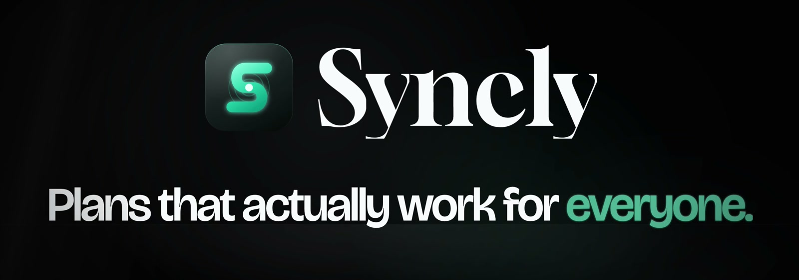
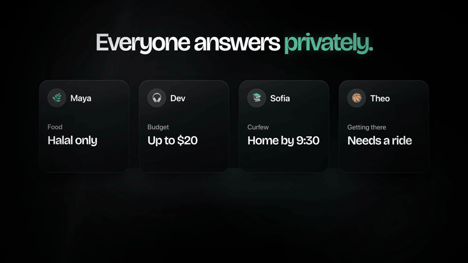
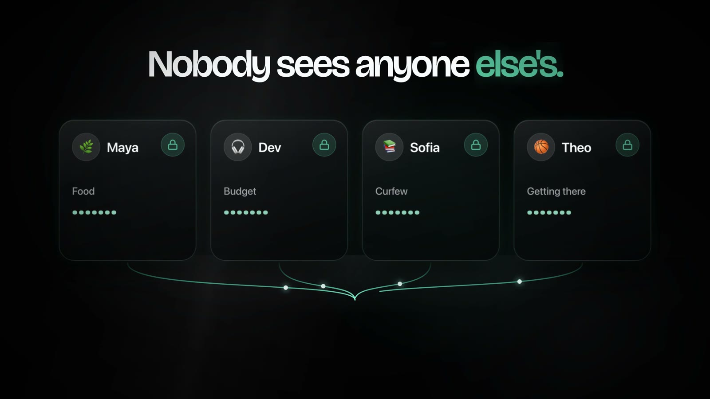
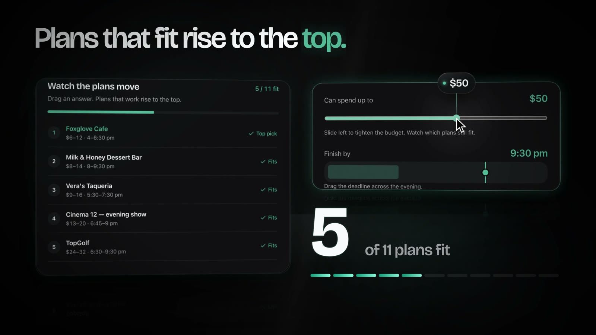
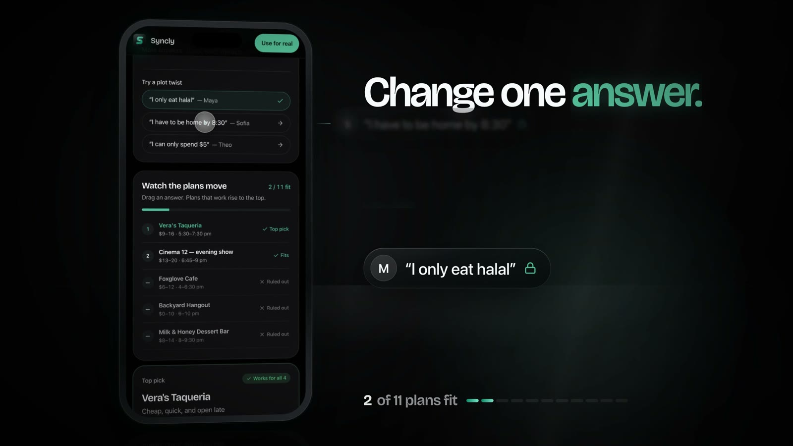
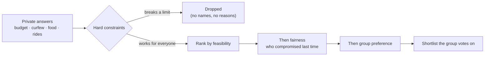

<p align="center">
  
</p>

<p align="center">
  <b>Group plans that work for everyone, without anyone saying their limits out loud.</b><br>
  Private constraint matching, ride solving, live location and parent approvals for teen friend groups.
</p>

<p align="center">
  <a href="https://syncly.website"><b>syncly.website</b></a>
  &nbsp;·&nbsp;
  <a href="https://syncly.website/demo">Try the demo</a>
</p>

<p align="center">
  
  
  
  
  
  
</p>

---

## The problem

Every Friday, the same group chat. *"I can't spend that much." "I have to be home by 10." "I can't eat there."* Someone always ends up quietly giving something up, and nobody wants to be the one who says why.

Syncly lets each person answer privately. The group only ever sees which plans work, never who a plan didn't work for or why.

<p align="center">
  
</p>

## How it works

<table>
  <tr>
    <td width="33%"></td>
    <td width="33%"></td>
    <td width="33%"></td>
  </tr>
  <tr>
    <td><b>Answer privately.</b><br>Budget, curfew, food, getting there. Nobody sees anyone else's.</td>
    <td><b>Plans that fit rise.</b><br>Options that break a hard limit drop out. The rest are ranked.</td>
    <td><b>Change one answer.</b><br>The shortlist re-ranks instantly, and still never says whose answer moved it.</td>
  </tr>
</table>

The core is a deterministic compatibility engine in [`src/lib/quorum/engine.ts`](src/lib/quorum/engine.ts). AI can suggest candidate options, but every option is scored by the engine, never by the model.



## Features

| | |
|---|---|
| **Private constraint matching** | Hard and soft constraints per member. The group sees "doesn't meet every requirement", never who or why. |
| **Fairness-aware ranking** | The same person isn't always the one who compromises. |
| **Ride solving** | Seats, drivers, distance limits and return times are solved as part of the plan, not in a separate thread. |
| **Live Radar** | Full-screen, real-time location sharing for the group during an outing. |
| **Family Hub** | Parents see plans, rides, safe zones and check-ins, and can approve, decline or approve with a condition from a link. No app download needed. |
| **AI itinerary** | Multi-stop plan suggestions narrated by Sync, with a Gemini → Groq model fallback chain. |
| **Chat and DMs** | Group chat and direct messages alongside every plan. |
| **Account security** | Email two-factor auth, cookie consent, and row-level security on every table. |
| **Installable** | PWA manifest for an add-to-home-screen app on iOS and Android. |

## Tech stack

- **Frontend:** React 19, TanStack Start + Router, Vite, Tailwind CSS 4, Radix UI, Motion, Mapbox GL
- **Backend:** Supabase (Postgres, Auth, Realtime), row-level security on every table, 36 SQL migrations
- **AI:** Vercel AI SDK with Google Gemini and Groq
- **Email:** Resend for two-factor codes and account emails
- **Quality:** Vitest suites for the engine, auth, MFA and RLS policies, plus ESLint, Prettier and strict TypeScript

## Project structure

```text
src/
├── routes/              # TanStack file-based routes (landing, demo, app, guardian approval links)
├── components/quorum/   # Product UI: plans, voting, Radar, Family Hub
├── lib/quorum/          # Compatibility engine, rides, AI, server functions
└── tests/               # Engine, auth, MFA and RLS test suites
supabase/
└── migrations/          # Schema, policies and functions
```

## Running locally

```sh
bun install
cp .env.example .env    # add your Supabase project URL and publishable key
bun run dev
```

| Command | What it does |
|---|---|
| `bun run dev` | Start the dev server |
| `bun run build` | Production build |
| `bun run test` | Run the test suite |
| `bun run test:rls` | Run row-level security policy tests against a live database |
| `bun run typecheck` | Type-check the project |
| `bun run lint` | Lint |

---

<p align="center">
  Built by <a href="https://github.com/aaravmuthu">Aarav Muthu</a>
</p>
